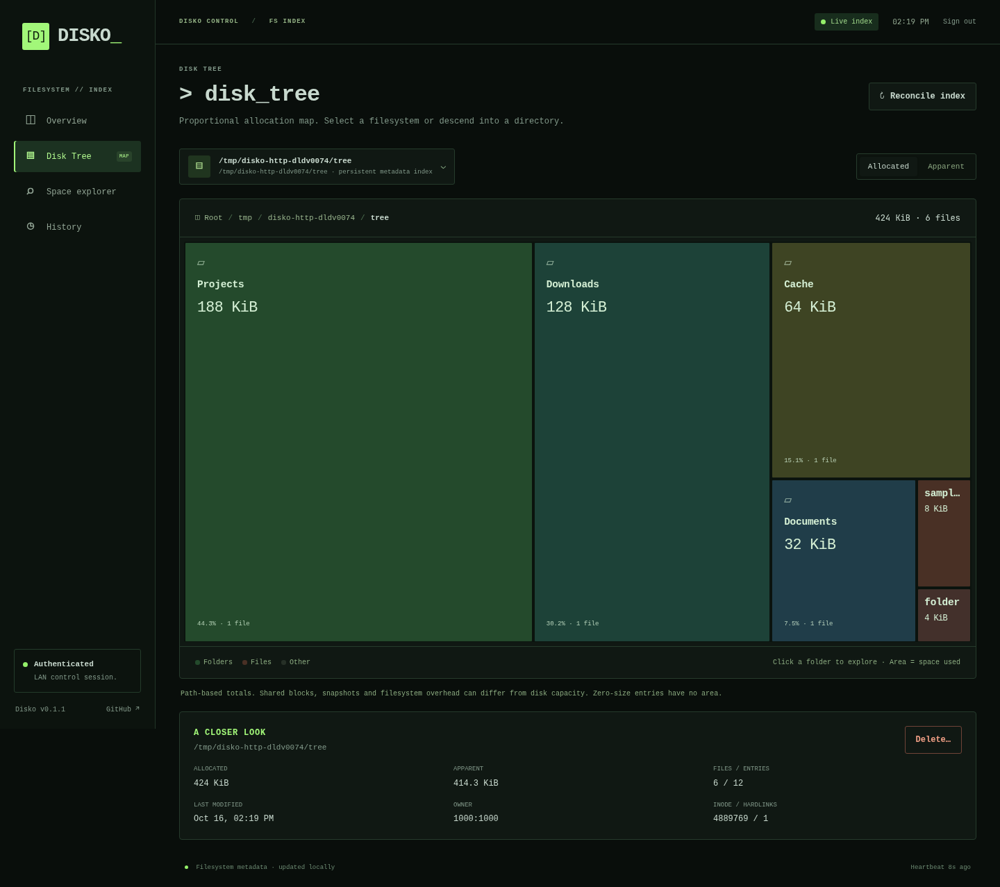

# Disko 🪩

[](https://github.com/olibuijr/disko/actions/workflows/ci.yml)
[](CHANGELOG.md)
[](LICENSE)

**A Rust filesystem indexing daemon for fast disk-space queries and live metadata.**

Disko keeps directory totals in SQLite and updates them from Linux filesystem
notifications. Its CLI and built-in web dashboard query that index, so checking
large folders does not require walking the filesystem again.

- **Disk Tree:** a proportional treemap with folder drill-down, breadcrumbs,
  a disk/index picker, and allocated/apparent size controls.
- **Console dashboard:** dark monospace UI with live status, processing rate,
  watcher health and disk capacity.
- **Space explorer:** largest files and folders, filename-prefix search and metadata.
- **History:** completed/interrupted scans, indexing-rate charts and recent changes.
- **File management:** authenticated deletion with a Cancel/Delete confirmation.
- **CLI:** JSON output and read-only SQL for scripts and agents.



## Install

Linux, Rust 1.88+ and SQLite are required. `build.sh` installs missing build
prerequisites on Arch, Debian/Ubuntu, Fedora, openSUSE and Alpine, and installs
Rust through [rustup](https://rust-lang.org/tools/install/) if it is missing.

```sh
git clone https://github.com/olibuijr/disko.git
cd disko
./build.sh --test --install
```

`--install` requires systemd and uses sudo to install the binary and enable the
service. Run the script as your normal user. It grants that user's primary group
read access to the metadata database. Other init systems can run the binary directly.

```sh
./build.sh                 # dependency checks and a locked release build
./build.sh --no-deps       # build on a prepared machine
./build.sh --test          # also run Rust integration tests
```

## User guide

### Open the dashboard

Open **http://0.0.0.0:7331** (or localhost) on the host, or **http://HOST_LAN_IP:7331** from
another device. The installed service listens on `0.0.0.0:7331`.

The initial password is **`disko`**. Set a different password for a shared LAN:

```sh
read -r -s -p 'New password: ' disko_password
printf '%s\n' "$disko_password" | sudo disko password
unset disko_password
sudo systemctl restart disko
```

Passwords are stored as salted Argon2id hashes. Sessions expire after 12 hours;
restarting the daemon invalidates them. The built-in server uses HTTP: use it on
a trusted LAN, or through an HTTPS reverse proxy/SSH tunnel. Do not expose its
port directly to the internet. See [access and security](docs/security.md).

### Read the overview

The first scan must enumerate the filesystem. While it runs, totals reflect
completed batches. Progress shows entries processed, elapsed time, current path
and processing rate; there is no guessed percentage. After scanning, filesystem
notifications maintain the index. **Reconcile index** requests another full scan.

Watch registration failures, unreadable entries and an offline writer appear as
health warnings. History records scan outcomes and rate samples. An interrupted
scan resumes through reconciliation at the next startup; committed batches remain queryable.

### Explore the Disk Tree

1. Open **Disk Tree** and select an index or mounted disk from the dropdown.
2. Each box represents an immediate child. Its area is proportional to space used.
3. Click a folder to enter it; use the breadcrumbs to go back.
4. Switch **Allocated** / **Apparent** to inspect on-disk allocation or logical size.
5. Click a file to inspect ownership, timestamps, inode and hardlink count.

The map shows the 200 largest children, grouping remaining bytes as **Other
entries**. Zero-size entries have no area. The dropdown lists the daemon's configured
index roots and mounted disks discovered within its coverage.

### Find and delete items

**Space explorer** lists the largest files or folders. Its search field matches
filename prefixes, case-sensitively. Select a file for details. A folder opens in
Disk Tree, where its details appear below the map.

Click **Delete…** to preview the selected item, then **Cancel** or **Delete**.
Deletion is permanent and removes folder contents. It is allowed only below
`/home`, `/mnt`, `/media`, `/tmp` and `/var/tmp`. Index roots, mount roots,
snapshots and system paths are refused. Ancestor symlinks are refused, and symlinks
inside a deleted folder are unlinked without following their targets.

The preview expires after two minutes and is tied to the session and inode.
The watcher updates the index after deletion; large operations may take time.
A failure can leave a folder partially deleted. Indexed size is not a promise of
how much space will be reclaimed.

### Use the CLI

```sh
disko du /home                         # biggest immediate children
disko largest                          # largest files globally
disko largest /home --kind dirs        # largest directory trees
disko largest --apparent               # logical rather than allocated size
disko info /path/to/file               # cached metadata and subtree totals
disko find node_mod                    # indexed filename-prefix search
disko find cache --contains            # substring search; scans index rows
disko --json du /mnt                   # structured output
disko status                           # coverage, freshness and health
```

A custom index can run without root. Keep the database outside the indexed roots:

```sh
export DISKO_DB="$HOME/.local/state/disko/index.db"
printf '%s\n' 'choose-a-password' | ./target/release/disko password
./target/release/disko watch ~/Projects ~/Downloads --listen 127.0.0.1:7331
```

`scan` reconciles once. `watch --no-web` disables HTTP. `serve` opens a dashboard
for an existing index without a writer; it cannot delete files or request scans.
Use a new database when changing coverage. [CLI, SQL and API details →](docs/reference.md)

### Operate the daemon

```sh
systemctl status disko
journalctl -u disko -f
sudo systemctl restart disko
sudo systemctl disable --now disko
```

The binary is `/usr/local/bin/disko`; database, history and password hash live in
`/var/lib/disko`. Stopping the service preserves them. Re-run
`./build.sh --install` to install an update and restart the service.

## Coverage and accounting

The service indexes `/`, including mounted disks and Btrfs subvolumes. It excludes
`/proc`, `/sys`, `/dev`, `/run`, its own state directory, and `.snapshots`
directories. USB disks under `/run/media` are therefore excluded. Symlinks are
recorded without following them; file contents are never read by the indexer.

Allocated bytes are `st_blocks × 512`. Totals count paths, including each hardlink.
Btrfs compression, reflinks, snapshots, excluded trees and filesystem overhead can
make index totals differ from `df`. These are not exclusive or reclaimable-byte
estimates. See [architecture and consistency](docs/architecture.md).

## Performance

A local benchmark with 100,000 sparse files in 200 folders indexed about 31,000
files/second. Median query times were 1–5 ms, including process startup, with a
roughly 22 MiB index. This fixture measures metadata indexing, not large-directory
or cold-cache worst cases. Reproduce it with:

```sh
python3 benchmark.py --files 100000
```

Global largest-file and prefix queries use indexes. Scoped largest queries use
best-first traversal. Broad SQL, substring searches and evenly distributed trees
can require more work.

## Contributing and agent use

Start with [SKILL.md](SKILL.md) for agent instructions and
[development checks](docs/development.md) for tests. Source files are kept small;
`tools/check_structure.py` enforces a 200-line limit for application source.

[Changelog](CHANGELOG.md) · [Architecture](docs/architecture.md) · [Security](docs/security.md) · [MIT license](LICENSE)
