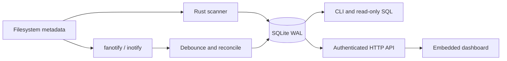

# Architecture

## Storage

`nodes` stores integer IDs, parent IDs and raw filename bytes. This avoids
repeating complete paths in every row. Parent/name pairs are unique; paths are
reconstructed for query results. ID 1 is the synthetic `/` root.

Every node stores its own size/allocation and subtree bytes, allocation, file
count and entry count. The writer combines ancestor deltas in memory and commits
batches of up to 4,096 changes, or after about two seconds of scan activity.
Readers use a single SQLite snapshot per query. A separate writer lock prevents
multiple daemon writers from corrupting aggregate accounting.

Size indexes serve global largest queries. Parent/kind/size indexes serve
child queries and a bounded merge in the web explorer. Scoped largest queries
traverse stored totals best-first, using directory totals as upper bounds.
Filename-prefix search uses a byte-range index; substring search scans rows.

## Watching

With the necessary privileges and filesystem support, fanotify marks entire
filesystems. A bounded reader decodes directory file handles and entry names,
resolves them through open mount descriptors, and queues metadata changes.
This avoids one inotify watch per directory on large supported filesystems.

Btrfs rejects filesystem marks on subvolumes other than the top level (`EXDEV`).
Disko then marks the whole Btrfs filesystem through a private, read-only,
detached mount of the top-level subvolume (`fsopen`/`fsmount`); nothing is
attached to the mount tree, and the mount disappears with the daemon. Event
handles are decoded on that mount and translated to real paths through each
subvolume's mountpoint in `/proc/self/mountinfo`. Nested subvolumes (inode 256,
not a mount root) count as covered. Unsupported or unprivileged paths use
inotify directory watches, installed before enumeration. Access/read events are ignored, while write-close events are retained.
A dedicated collector keeps draining events during full scans and coalesces
repeated writes by path. The event channel and pending-path map are each bounded
at 65,536 entries. Live updates use a 250 ms coalescing window.
The scanner skips `.snapshots`, virtual filesystems and its state directory.

Rename handling reconciles old and new subtrees. Hardlink writes refresh indexed
sibling paths. Queue overflow and watcher errors request a full reconciliation.
A scheduled reconciliation also runs once a day. When more than 65,536 distinct
paths are pending (for example during a long scan), they merge into their parent
directories as recursive resyncs instead of forcing a rescan of every root. Metadata read failures
preserve old information instead of assuming the inaccessible subtree was deleted.

Events are hints about current state, not an ordered filesystem journal. Remote
writes, mount changes and rare races may require reconciliation. Registration
failures are visible in status and logs. Disko does not silently change kernel
watch limits.

## History

`scans` retains 100 scan outcomes, including interrupted runs. `samples` retains
seven days of 30-second samples, and `activity` retains 2,000 coalesced path
updates. The dashboard displays at most 720 recent samples and 60 changes.
No file contents enter the database.

## HTTP and deletion

Four HTTP workers serve assets embedded in the binary and snapshot-based API
queries. No frontend toolchain or external asset service is required at runtime.
Authentication, request validation and deletion are separate Rust modules.
See [security.md](security.md) for the mutation boundary and known limits.

## Mounts

The daemon rereads `/proc/self/mountinfo` every two seconds. A new or removed
mount below a root is marked for fanotify (if supported), its mountpoint is
resynced, and watches below it are reset. Decoding opens a current mountpoint
per event instead of holding descriptors, so Disko never keeps a filesystem
busy and `umount` keeps working. Overlay mounts and bind mounts that show a
directory already visible elsewhere on the same filesystem are recorded but not
descended, so their contents are not counted twice.

## Coverage changes

Roots are fixed for an index. Exclusions can change in place: on startup, newly
excluded trees are removed from the index and newly included ones are indexed
by the startup scan.

## Disk accounting

`status` and the dashboard report each filesystem once (Btrfs subvolumes are
grouped by device) with capacity, free and used space, the space indexed paths
account for, and the difference. That difference is mostly snapshots, excluded
trees and filesystem metadata, offset by compression and shared extents.

## Low disk space

With less than 1 GiB free on the index's filesystem, full scans wait (status
`waiting for disk space`) while event processing continues. A failing service
restarts with a backoff of up to 30 minutes.

